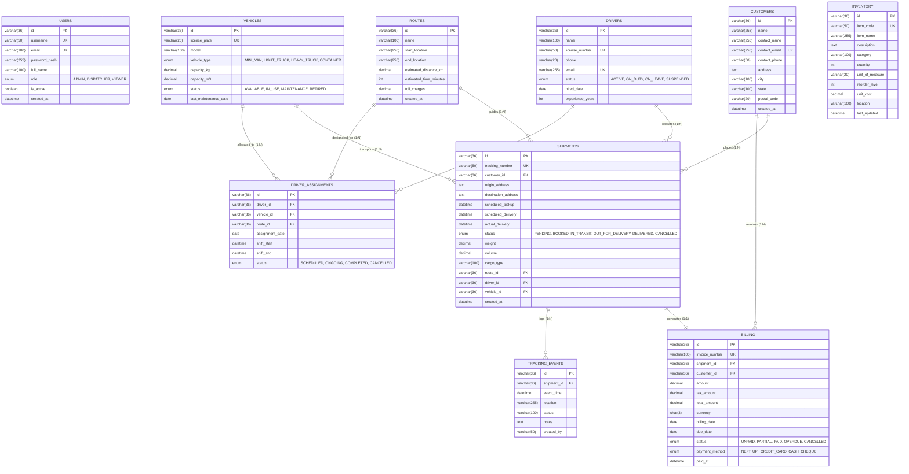

# Entity-Relationship (ER) Model Documentation
## Swift Route Logistics Manager
**Course:** 21CSC205P Database Management Systems  
**Institution:** SRM Institute of Science and Technology  
**Student:** Krishang Gupta (RA2411026010810)  
**Supervisor:** Dr. Amit Kukker  

---

## 1. Conceptual ER Diagram (Chen & Crow's Foot Notation)

The system models a modern parcel and freight logistics dispatch infrastructure. The entities, attributes, and relationships are structured below:

---

## 2. Cardinality and Participation Constraints

1. **Customer places Shipment (1:N)**:
   - A Customer can place zero, one, or many shipments over time.
   - Each Shipment must belong to exactly one Customer (`customer_id NOT NULL`, `ON DELETE RESTRICT`).

2. **Shipment assigned to Driver & Vehicle (N:1)**:
   - A Driver may transport multiple shipments sequentially over their tenure, but each active shipment has at most one primary driver.
   - A Vehicle may be utilized for multiple shipments sequentially, but each shipment is transported by at most one primary vehicle.

3. **Shipment follows Route (N:1)**:
   - A predefined Route (e.g. Chennai to Bengaluru Corridor) can serve hundreds of independent shipments over time.

4. **Shipment has Tracking Events (1:N)**:
   - Every shipment generates a chronological log of tracking events (`ON DELETE CASCADE`).
   - Trigger `trg_after_shipment_insert` automatically inserts the first event (`BOOKED` or `PENDING`).

5. **Shipment generates Billing Invoice (1:1)**:
   - Each shipment is linked to exactly one invoice. `total_amount` is calculated as a stored generated column (`amount + tax_amount`).

6. **Driver Assignments Junction (M:N with Schedule)**:
   - Resolves the complex ternary relationship between Drivers, Vehicles, and Routes over discrete scheduling intervals (`assignment_date`, `shift_start`, `shift_end`).
